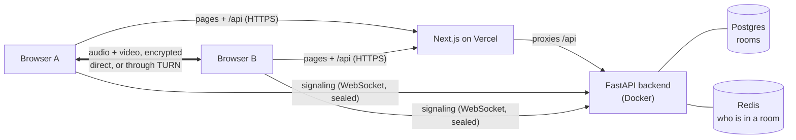

# Kolo

Video calls for two. You open the site, tap once, send a link, and talk. No accounts, no installs.

Calls are end-to-end encrypted: the key is made in your browser and travels only inside the link.
The server that connects the two of you never sees it.

## What it does

- A room in one tap, a link to share, or a short code to type in.
- 1-on-1 video and audio straight between the two browsers (WebRTC).
- End-to-end encryption of every audio and video frame, plus a safety code you can read out loud.
- Survives bad networks: reconnects by itself, finds a new path when you switch from Wi-Fi to mobile.
- Waiting room, if you want to approve guests first.
- Invites through a Telegram bot (optional).
- Remembers the people you called. Only in your browser, there is no user database.

## How it works



The backend only introduces the two browsers to each other ("signaling"). After that the media
goes directly between them. The backend keeps rooms in Postgres and "who is here right now" in Redis.

| Folder | What is inside |
| --- | --- |
| `frontend/` | Next.js app: the home screen, the call, the crypto |
| `backend/` | FastAPI: rooms, join tickets, the signaling WebSocket |
| `notify/` | Telegram bot for invites (a separate small service) |
| `infra/` | Docker Compose for the backend |
| `lab/` | A closed Docker lab that attacks Kolo and breaks its network on purpose |
| `sdk/`, `tools/` | A small Python client and helper scripts |

## Run it locally

You need Docker and Node 22+.

**1. Backend**

```bash
cp infra/.env.example infra/.env
# add two secrets to infra/.env:
python3 -c "import secrets; print('KOLO_JWT_SECRET=' + secrets.token_urlsafe(48))" >> infra/.env
python3 -c "import secrets; print('KOLO_TURN_SECRET=' + secrets.token_urlsafe(32))" >> infra/.env

make up        # starts Postgres, Redis and the api, waits until it answers
```

The api is now on http://localhost:8000 (`/health` says ok). After backend changes: `make rebuild`.

**2. Frontend**

```bash
cd frontend
cp .env.example .env.local
npm install
npm run dev    # http://localhost:3000
```

`frontend/.env.example`:

```bash
# where /api is proxied to (server side)
BACKEND_URL=http://localhost:8000
# the backend's public url, the browser opens its WebSocket there
NEXT_PUBLIC_API_URL=http://localhost:8000
# optional: the same value as KOLO_PROXY_SECRET on the backend
KOLO_PROXY_SECRET=
```

Open http://localhost:3000 in two browser windows and call yourself.
Camera and microphone only work on `https://` or `localhost`.

## Security

Short version:

- **End-to-end encryption.** Each room gets a 256-bit key, made in the browser. It sits in the part
  of the link after `#`, which browsers never send to any server. Every audio and video frame is
  encrypted with it (AES-GCM, on top of WebRTC's own encryption), and so is the signaling.
- **Safety code.** Ten digits both sides see in the call details. They are made from the keys the two
  browsers really use. If someone sat in the middle, the two codes would differ. Read them out loud once.
- **No silent downgrade.** If someone joins without the key (they typed the code, or came from the
  Telegram bot), nothing connects until you press "Call anyway", and the call says it is not end-to-end.
- **Around it:** short-lived join tickets, rate limits on creating and looking up rooms, strict CORS,
  a Content-Security-Policy with nonces, no third-party scripts, temporary TURN logins.

What it does not hide: that a call happens, when, for how long, and how much data flows. Anyone on your
network can see that. Your IP address is visible to the other person unless you turn on
"Hide my IP address" (needs a TURN relay).

The details are in [`frontend/src/lib/e2ee.ts`](frontend/src/lib/e2ee.ts), it is short and has no dependencies.

## Tests

```bash
# backend: every endpoint, signaling, rate limits, tickets
cd backend && uv run pytest

# frontend: the crypto (keys, sealed signaling, frames, safety code)
cd frontend && npm test

# two real browsers with fake cameras, against the running backend and frontend
cd frontend && npm run e2e          # a call, the waiting room
cd frontend && npm run e2e:e2ee     # encryption checked from the outside
```

The lab runs everything in Docker on closed networks. Two browsers call each other through a router
that belongs to an "attacker": it listens, opens TLS with a trusted certificate, rewrites the signaling,
guesses room codes, and breaks the network (packet loss, "only TCP 443", a new IP in the middle of a call).

```bash
./lab/run.sh all     # ~15 min, results in lab/results/
./lab/run.sh down    # removes everything it made
```

## Stack

- **Frontend:** Next.js 16, React 19, TypeScript, WebRTC, Web Crypto, Insertable Streams
- **Backend:** Python 3.12, FastAPI, WebSockets, Postgres, Redis, PyJWT
- **Bot:** aiogram, on Vercel
- **Tests:** pytest, Node's test runner, Playwright, mitmproxy, tcpdump, coturn
- **Hosting:** Vercel for the frontend, Docker for the backend
